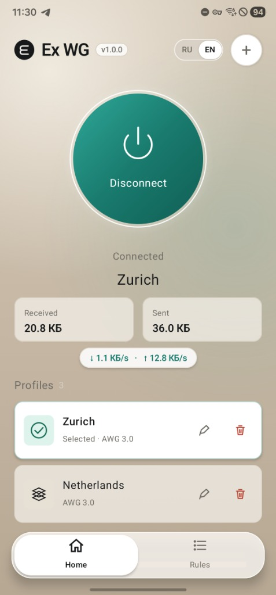
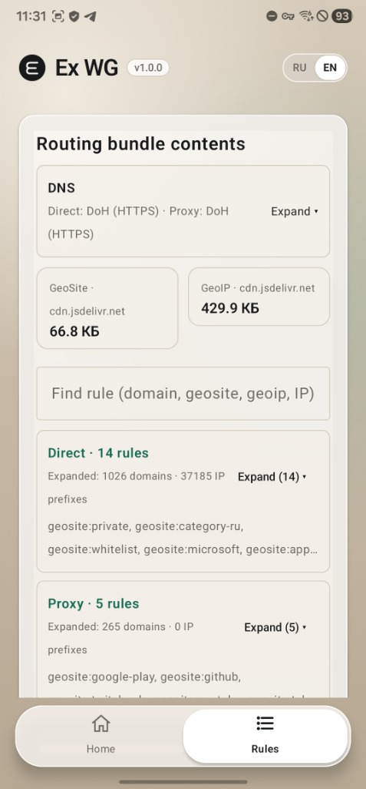

# Ex WG for Android

[**English**](#english) · [**Русский**](#русский)

<p align="center">
  
  &nbsp;&nbsp;&nbsp;
  
</p>

---

<a name="english"></a>

## English

Native Android client for **AmneziaWG (AWG 2.1 / 3.0 / 3.1)** with domain-based split routing (`Direct / Proxy / Block`, `geosite.dat`, `geoip.dat`, `TLS SNI / HTTP Host`) and leak-free split DNS (`DoH` / `DoT` / `FakeDNS`).

- **Version**: `1.0.0` (Android 6.0+ / `minSdk 23`, `targetSdk 36`)
- **Core**: Official [`amneziawg-go/v3`](https://github.com/amnezia-vpn/amneziawg-go/tree/v3.1.20260814) (`v3.1.20260814`) + `gVisor` TCP/UDP stack
- **Desktop Companion**: **Ex WG for Windows** (`1.0.0`)
- **License**: [`MIT`](LICENSE) (third-party notices in [`THIRD_PARTY_NOTICES.md`](THIRD_PARTY_NOTICES.md))
- **Feedback & Suggestions**: Telegram [@nexus_ray](https://t.me/nexus_ray)

### Key Features

- **Domain & Geo Split Routing**: Routes `Direct` traffic (local services, banking, domestic apps) straight through physical network sockets (`VpnService.protect()`) and `Proxy` traffic through the encrypted AmneziaWG tunnel using domain rules, `geosite.dat`, `geoip.dat`, and route-only `TLS SNI / HTTP Host` inspection.
- **Split Encrypted DNS**: Resolves `Direct` domains via Domestic DNS and `Proxy` domains strictly inside the tunnel (`DoH` HTTP/2, `DoT`, TCP, UDP, `FakeDNS`) with `Stale-While-Revalidate` caching and `DoH` pre-warming.
- **Universal Rules & 1-Tap Overrides**: Supports `https://routing.help/`, `happ://routing/...` deep links, Base64, JSON, and plain-text lists, plus an offline `geosite.dat` + `geoip.dat` bundle out of the box. Override any domain or category (`Direct` / `Proxy` / `Block`) in one tap on the **Rules** tab.
- **Fail-Closed & Seamless Roaming**: `Proxy` flows never leak to `Direct` on failure. **Hot-Switch** profile switching and `Wi-Fi ↔ LTE/5G` roaming keep the system `TUN` interface alive. Configs and keys are encrypted via hardware **Android Keystore (`AES-256-GCM`)**.
- **In-App Updates**: Checks GitHub Releases, picks the right device ABI APK (`arm64-v8a`, `armeabi-v7a`, `x86_64`), verifies `SHA-256`, and launches the system installer. Tap **`v1.0.0`** once in the top bar to check manually.
- **Diagnostics Mode**: Tap the **`v1.0.0`** badge in the top bar **5 times** to open or hide connection diagnostics and event logs.

### Project Structure

| Module | Description |
| --- | --- |
| `app/` | Jetpack Compose UI (`Mini App Glass`), `NexusVpnService`, `TunnelManager`, `RoutingRepository`, `AppUpdateManager`, `ProfileStore` |
| `core/` | `.conf` / `.zip` / QR parser & validator, routing profile parser, GitHub Releases `SHA-256` verifier, log rotation & secret masking |
| `core-go/` | Go dataplane (`nexuscore.aar`): `amneziawg-go/v3`, `gVisor` stack, SNI/Host sniffer, split DNS resolver, `geosite`/`geoip` matcher |
| `tunnel/` | AmneziaWG configuration model and UAPI serializer (`org.amnezia.awg.config.*`) |

### Build

Requires **Android SDK 36**, **NDK `26.1.10909125`**, **JDK 17**, and **Go 1.26+**:

```powershell
.\build-on-windows.ps1
```

---

<a name="русский"></a>

## Русский

Нативный Android-клиент **AmneziaWG (AWG 2.1 / 3.0 / 3.1)** со встроенной доменной маршрутизацией (`Direct / Proxy / Block`, `geosite.dat`, `geoip.dat`, `TLS SNI / HTTP Host`) и раздельным зашифрованным DNS (`DoH` / `DoT` / `FakeDNS`).

- **Версия**: `1.0.0` (Android 6.0+ / `minSdk 23`, `targetSdk 36`)
- **Ядро**: официальный [`amneziawg-go/v3`](https://github.com/amnezia-vpn/amneziawg-go/tree/v3.1.20260814) (`v3.1.20260814`) + стек `gVisor`
- **Десктопная версия**: **Ex WG for Windows** (`1.0.0`)
- **Лицензия**: [`MIT`](LICENSE) (уведомления сторонних библиотек — в [`THIRD_PARTY_NOTICES.md`](THIRD_PARTY_NOTICES.md))
- **Обратная связь и предложения**: Telegram [@nexus_ray](https://t.me/nexus_ray)

### Основные возможности

- **Раздельная маршрутизация внутри одного TUN**: Направляет российские сайты и банки (`Direct`) напрямую мимо VPN через защищённые сокеты (`VpnService.protect()`), а трафик `Proxy` — через туннель AmneziaWG (по доменам, `geosite.dat`, `geoip.dat` и заголовкам `TLS SNI / HTTP Host` без MITM).
- **Раздельный DNS без утечек**: Разрешает `Direct`-домены через Domestic DNS, а `Proxy`-домены — строго внутри туннеля (`DoH` HTTP/2, `DoT`, TCP, UDP, `FakeDNS`) с кэшем `Stale-While-Revalidate` и прогревом `DoH`.
- **Универсальные правила и переопределения в 1 тап**: Поддержка подписок (`https://routing.help/`, `happ://routing/...`, Base64, JSON) и встроенная офлайн-база `geosite.dat` + `geoip.dat`. На вкладке **«Правила»** можно проверить маршрут любого домена и переключить категорию (`Direct` / `Proxy` / `Block`).
- **Надёжность и безопасность (Fail-Closed)**: Трафик `Proxy` никогда не уходит в `Direct` при сбое сети. Переключение профилей (**Hot-Switch**) и смена сети (`Wi-Fi ↔ LTE/5G`) работают без разрыва `TUN`. Ключи зашифрованы в **Android Keystore (`AES-256-GCM`)**.
- **Автообновление в 1 клик**: Проверка GitHub Releases, выбор APK под архитектуру устройства (`arm64-v8a`, `armeabi-v7a`, `x86_64`), сверка `SHA-256` и запуск системного установщика. Одиночное нажатие на плашку **`v1.0.0`** запускает проверку обновлений вручную.
- **Режим диагностики**: Нажмите **5 раз подряд** на плашку **`v1.0.0`** в верхней шапке, чтобы открыть или скрыть диагностику маршрутов и лог событий.

### Структура проекта

| Модуль | Назначение |
| --- | --- |
| `app/` | UI на Jetpack Compose (`Mini App Glass`), `NexusVpnService`, `TunnelManager`, `RoutingRepository`, `AppUpdateManager`, `ProfileStore` |
| `core/` | Парсер и валидатор `.conf` / `.zip` / QR, парсер профилей маршрутизации, проверка релизов и `SHA-256`, маскирование ключей |
| `core-go/` | Go dataplane (`nexuscore.aar`): `amneziawg-go/v3`, стек `gVisor`, SNI/Host sniffer, DNS-резолвер, гео-матчер (`geosite`/`geoip`) |
| `tunnel/` | Java-модель и UAPI-сериализатор конфигурации AmneziaWG (`org.amnezia.awg.config.*`) |

### Лицензии

Проект распространяется под лицензией [`MIT`](LICENSE). Сторонние лицензии и уведомления приведены в [`THIRD_PARTY_NOTICES.md`](THIRD_PARTY_NOTICES.md) и [`core-go/internal/geodata/LICENSE`](core-go/internal/geodata/LICENSE).
